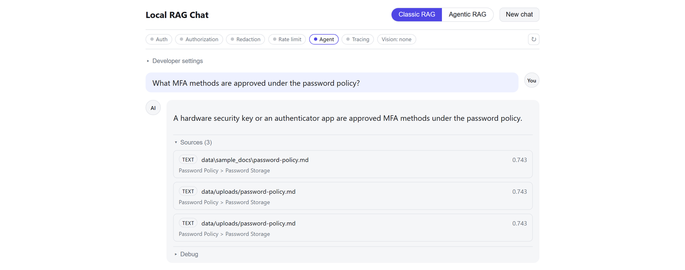

# local-rag-system

[](https://github.com/ajits-github/local-rag-system/actions/workflows/ci.yml)
[](https://github.com/astral-sh/ruff)


[](#documentation)


[](https://fastapi.tiangolo.com)
[](https://www.postgresql.org)
[](https://github.com/pgvector/pgvector)
[](https://ollama.com)
[](https://www.docker.com)

A local, modular Retrieval-Augmented Generation system built for offline
experimentation. It uses sentence-transformers for embeddings,
PostgreSQL + pgvector for storage, Ollama for generation, and FastAPI for
serving.

The main idea is simple: every important part of the RAG pipeline is
config-driven. Embeddings, chunking, retrieval mode, reranking,
generation, security controls, observability, MCP, and GraphRAG can be
swapped or enabled from `config/default.yaml` without rewriting the
pipeline code.

The quickest path is:

1. Install the Python package.
2. Start Postgres.
3. Ingest `data/sample_docs`.
4. Start the API.
5. Call `/query`.

The full setup is below.

## What This Project Includes

- Offline, CPU-friendly RAG with no hosted API key required by default.
- Dense retrieval, optional hybrid dense + BM25 retrieval, and optional reranking.
- PDF, DOCX, HTML, Markdown, and text ingestion with layout-aware parsing.
- Classic RAG through `POST /query`.
- Optional bounded Agentic RAG through `POST /agent/query`.
- Optional MCP server/client integration for external tool access and synthetic business tools.
- Optional Neo4j-backed Knowledge Graph / GraphRAG path.
- Optional RDF/RDFS/OWL/SHACL/SPARQL ontology layer on top of the graph, for
  class-hierarchy-aware retrieval (CLI/eval only today, not wired into the API).
- Optional JWT auth, tenant/role authorization, field redaction, rate limiting, and audit logging.
- Optional OpenTelemetry, Prometheus, Grafana, and live agent progress streaming.
- A small React web UI for testing classic and agentic RAG.
- Deterministic evaluation scripts, optional RAGAS judging, and tracked experiment records.
- Several additional learning-exercise branches, not merged into `main`:
  Kubernetes/Helm/distributed-state deployment, and single- and multi-agent
  LangGraph exercises. See [Experiment Branches](#experiment-branches) below.

Jump to a section below, or build the [docs site](#documentation) for
deeper design write-ups and the generated API reference:

- [Architecture](#architecture)
- [Security](#security)
- [Ingestion](#multimodal--layout-aware-ingestion)
- [Retrieval](#retrieval)
- [Evaluation](#evaluation)
- [Agentic RAG](#agentic-rag)
- [MCP](#mcp)
- [GraphRAG](#knowledge-graph--graphrag)
- [Ontology & Semantic Layer](#ontology--semantic-layer)
- [Observability](#observability)
- [Web UI](#web-ui)
- [Feedback](#feedback-loop)
- [Deployment](#deployment)
- [Metrics reference](#metrics-reference)

## Architecture


Two pieces of this diagram are ahead of what's implemented today, not
built capabilities: **Context Engineering** is planned next (today,
context sizing is three explicit cutoffs, see
[Retrieval](#retrieval), not a dedicated budgeting/packing stage), and
**Conversation / history** / **conversation continuity** don't exist
yet either, every `/query` and `/agent/query` call is stateless; the
web UI only keeps a client-side message list for display. **NDCG** also
isn't an implemented metric; Recall@k, hit-rate, MRR, and RAGAS are what
`eval/run_eval.py` actually computes (see
[Metrics reference](#metrics-reference)).

| Area | Default implementation | Notes |
|---|---|---|
| Embeddings | `sentence-transformers/all-MiniLM-L6-v2` | CPU by default |
| Vector store | PostgreSQL + pgvector | Uses `DATABASE_URL` |
| Chunking | Structured Markdown chunker | Preserves document structure |
| Retrieval | Dense search | Hybrid search is configurable |
| Reranking | Off | Cross-encoder/Cohere paths exist |
| Generation | Ollama `qwen2.5:1.5b` | Uses `OLLAMA_BASE_URL` |
| API | FastAPI | Main endpoints: `/query`, `/agent/query`, `/health` |
| UI | React/Vite | Optional, in `frontend/` |
| Security | Off by default | Enable under `config.security.*` |
| GraphRAG | Off by default | Enable under `graph.*` |
| Ontology | RDF/RDFS/OWL/SHACL/SPARQL | CLI/eval only today |
| Context Engineering | Not yet implemented | Planned next |

## Multimodal & Layout-Aware Ingestion

PDF and DOCX documents are parsed with their structure intact where
possible: headings, tables, code/config blocks, images, page numbers, and
source metadata are preserved into Markdown-like content before chunking.

An optional local vision provider can describe images through Ollama
(`vision.provider: ollama`), but it is experimental and off by default.
See [Multimodal & Layout](docs/topics/multimodal.md).

## Retrieval

`retrieval.provider` selects `dense` (pure vector similarity) or
`hybrid` (dense + BM25 keyword search, fused via Reciprocal Rank Fusion
before reranking, since a cosine-similarity score and an unbounded BM25
score are never on a comparable scale). Context sizing is three
independent, explicitly-named cutoffs rather than one overloaded
"top k": `candidate_k` (how many candidates each branch fetches),
`reranker_top_n` (how many a real reranker keeps after rescoring), and
`generation_context_top_n` (how many ranked chunks reach the prompt).

An optional post-rerank relationship-expansion step and field-level
redaction pass both run inside the same retrieval pipeline; see
[Security](#security). See [Retrieval](docs/topics/retrieval.md) for
the cutoff-semantics writeup and API reference.

<!-- --8<-- [start:docs-agentic-rag] -->
## Agentic RAG

`POST /agent/query` is an optional bounded workflow above the classic
`POST /query` path. It can route simple questions to classic RAG and use a
small tool loop for complex or multi-hop questions. The graph is bounded
by `max_agent_steps`, `max_retrieval_attempts`, and `max_tool_calls`, and
uses the same retrieval authorization, freshness, redaction, and injection
checks as the classic path.
<!-- --8<-- [end:docs-agentic-rag] -->

The agent is deliberately not an open-ended autonomous loop. The model is
asked for structured decisions, Python validates them, and server-side
limits decide when the run stops. See [Agentic RAG](docs/topics/agentic-rag.md).

<!-- --8<-- [start:docs-mcp] -->
## MCP

The optional MCP server exposes the same hardened RAG tools used by the
in-process agent over Streamable HTTP. Identity is resolved from the
transport, not from model-supplied tool arguments, and tool outputs pass
through the same sanitization path as normal agent evidence.

The same MCP layer also includes a small synthetic customer-support
backend with read tools and one guarded write action, so the project can
demonstrate MCP as a real integration layer instead of only another way
to call the RAG pipeline.
<!-- --8<-- [end:docs-mcp] -->

MCP is off by default with `mcp.enabled: false`,
`mcp.client.enabled: false`, and `mcp.business_actions.enabled: false`.
See [MCP](docs/topics/mcp.md).

<!-- --8<-- [start:docs-graphrag] -->
## Knowledge Graph & GraphRAG

GraphRAG is an optional Neo4j-backed capability. It builds a property
graph of entities and relationships from the corpus and can combine graph
traversal with the existing dense/hybrid vector pipeline.

It is additive, not a replacement for classic RAG. `POST /query` remains
unchanged; graph access is available through explicit agent tools and the
separate `POST /graph/query` endpoint when `graph.enabled: true`.
<!-- --8<-- [end:docs-graphrag] -->

GraphRAG is off by default. See [Knowledge Graph & GraphRAG](docs/topics/graphrag.md).

## Ontology & Semantic Layer

An optional RDF/RDFS/OWL/SHACL/SPARQL semantic layer (`rag.ontology`) sits
on top of the GraphRAG property graph, for the kind of class-hierarchy
reasoning a flat Neo4j label set cannot express on its own: a query for
"every Service" can also match something only ever typed `DatabaseService`,
a real, measured recall improvement, not a hypothetical one.

It is additive, like GraphRAG itself: nothing in `rag.graph` changes, and
this layer reuses GraphRAG's own authorization function directly rather
than re-implementing it, so inference never grants access on its own.
Today it is reachable through `scripts/ontology_demo.py` and
`python -m rag.eval.run_ontology_eval`, not wired into the API or the agent.

See [Ontology & Semantic Layer](docs/topics/ontology.md) for the full
RDF/RDFS/OWL/SHACL/SPARQL walkthrough against real data, the
property-graph-vs-RDF comparison, and 25 interview questions.

<!-- --8<-- [start:docs-security] -->
## Security

Retrieval-time tenant/role authorization, document-version freshness,
field-level sensitive-data redaction, prompt-injection detection, and an
authenticated API boundary (JWT verification, DoS limits, rate limiting)
all sit above both the classic and agentic RAG paths, each independently
toggleable and off by default (`config.security.*`). Authentication
happens at the API boundary; authorization stays enforced entirely at
retrieval, as two structurally separate modules.
<!-- --8<-- [end:docs-security] -->

This is a portfolio/local system, not a hosted production service. The
implemented controls are still tested seriously; see [Security](SECURITY.md)
and [Security design](docs/topics/security.md).

<!-- --8<-- [start:docs-observability] -->
## Observability

The project can expose request metrics, live agent progress, distributed
traces, and a local Grafana dashboard. `/metrics` and
`POST /agent/query/stream` are enabled by default; tracing is off by
default because it needs an OTLP endpoint.

```bash
# set observability.tracing.enabled: true in config/default.yaml first
make observability-up
```

This starts Prometheus at `http://localhost:9090`, Grafana at
`http://localhost:3000`, and Jaeger at `http://localhost:16686`.
<!-- --8<-- [end:docs-observability] -->

`GET /` returns which security/agent/vision/tracing features are
currently enabled (booleans and provider names only, nothing
identifying), and `GET /info` returns the concrete model/provider
identity those flags intentionally omit. Both exist so the active
configuration is always visible at a glance, after a real incident
where a demo looked compromised because its running config had every
security control silently off and nothing in the UI said so.

See [Observability](docs/topics/observability.md).

<!-- --8<-- [start:docs-web-ui] -->
## Web UI

A React/Vite/TypeScript chat UI lives in `frontend/`. It can call classic
RAG or Agentic RAG, show source citations, stream agent progress, and
display the backend feature flags returned by the API.
<!-- --8<-- [end:docs-web-ui] -->



*The local Web UI showing a classic RAG answer, backend feature flags,
and expandable source citations from the retrieved chunks.*

<!-- --8<-- [start:docs-web-ui-setup] -->
```bash
make up             # backend only: Postgres + rag-api
make frontend-up    # backend + frontend, http://localhost:3001
```

For local frontend development against an already-running backend:

```bash
cd frontend
npm install
npm run dev         # http://localhost:5173
```
<!-- --8<-- [end:docs-web-ui-setup] -->

See [frontend/README.md](frontend/README.md).

<!-- --8<-- [start:docs-feedback] -->
## Feedback Loop

`POST /feedback` stores a user's positive or negative rating for a
previous answer, tied to the answer's `request_id`. Feedback is scoped by
tenant and caller in the same way as `/query`.

Feedback is never treated as ground truth or automatically promoted into
evaluation data. It is stored for human review and can be exported with
`scripts/export_feedback.py`.
<!-- --8<-- [end:docs-feedback] -->

See [Feedback](docs/topics/feedback.md).

## Prerequisites

<!-- --8<-- [start:docs-prereq-setup] -->
You need:

- Python 3.11 or newer.
- Docker Desktop or Docker Engine with Docker Compose V2.
- Ollama running on the host machine.
- `make` is optional. If it is not installed, use the explicit commands
  shown next to each Makefile shortcut below.
- The default generation model:

```bash
ollama pull qwen2.5:1.5b
```

Optional models:

```bash
ollama pull qwen2.5:3b   # useful for heavier local experiments
ollama pull moondream    # only needed for optional image descriptions
```

Create a virtual environment and install the project:

```bash
python -m venv .venv
.\.venv\Scripts\Activate.ps1
pip install -e ".[dev]"
```

On macOS/Linux:

```bash
python -m venv .venv
source .venv/bin/activate
pip install -e ".[dev]"
```

Create a local environment file:

```bash
copy .env.example .env
```

On macOS/Linux:

```bash
cp .env.example .env
```

## Setup

Start Postgres + pgvector and initialize the schema:

```bash
make up
```

If `make` is not available:

```bash
docker compose up -d
python scripts/init_db.py
```

Ingest the sample documents:

```bash
make ingest FILE=data/sample_docs DATASET_ID=sample_docs
```

Without `make`:

```bash
python -m rag.ingestion.pipeline data/sample_docs --dataset-id sample_docs
```

Any file or directory can be ingested. Use a different `DATASET_ID` /
`--dataset-id` when you ingest a separate corpus. Re-running ingestion on
unchanged files is a no-op; edited files are detected and re-chunked.

Start the API natively:

```bash
uvicorn rag.api.main:app --reload
```

The API will be available at:

- `http://localhost:8000`
- `http://localhost:8000/docs`
- `http://localhost:8000/health`

Ask a sample question:

```bash
make query Q="What are the deployment windows for production releases?"
```

Or call the API directly:

```bash
curl -s -X POST http://localhost:8000/query \
  -H "Content-Type: application/json" \
  -d "{\"query\":\"What are the deployment windows for production releases?\",\"dataset_id\":\"sample_docs\"}"
```

Useful local commands:

```bash
make test          # run tests
make down          # stop the base Docker stack
make frontend-up   # start the optional web UI
make graph-up      # start optional Neo4j for GraphRAG
```
<!-- --8<-- [end:docs-prereq-setup] -->

## Containerized Development

<!-- --8<-- [start:docs-containerized-dev] -->
For the simplest containerized run:

```bash
docker compose up -d --build
```

This starts:

- Postgres + pgvector on host port `15987`.
- The API on `http://localhost:8000`.

Ollama still runs on the host. The API container reaches it through
`host.docker.internal` by default.

Stop the stack:

```bash
docker compose down
```

Add `-v` only when you also want to delete the Postgres volume.

For a production-shaped local run:

```bash
docker compose -f docker-compose.yml -f docker-compose.prod.yml up -d --build
```

To run the API with another config file:

```bash
RAG_CONFIG_PATH=/app/config/production.yaml docker compose up -d
```

`config/default.yaml` is a zero-setup demo profile: every security
control (auth, authorization, field redaction, rate limiting, tracing)
is off so the quickest-path setup above works with no extra
configuration. `config/production.yaml` turns all of those on and
switches to the stricter generation prompt; it is the config this
project actually recommends for anything beyond local experimentation.
See `docs/topics/deployment.md`.

For Windows, keep Docker Desktop and Ollama running before starting the
stack. If Ollama is not reachable, the API still starts, but generation
requests will fail until Ollama is available.
<!-- --8<-- [end:docs-containerized-dev] -->

## Deployment

Postgres + pgvector and the API are containerized; Ollama stays native
on the host, and the containerized API reaches it through
`host.docker.internal`. See [Containerized Development](#containerized-development)
above for the exact commands, and `config/production.yaml` for the
profile this project recommends beyond local experimentation (auth,
authorization, field redaction, rate limiting, and tracing all on).

Optional overlays add the frontend (`docker-compose.frontend.yml`) or an
observability stack (`docker-compose.observability.yml`) on top of the
same base stack. Kubernetes and Helm variants exist as separate,
unmerged learning-exercise branches; see
[Experiment Branches](#experiment-branches).

See [Deployment](docs/topics/deployment.md) for the full write-up,
including how to build this documentation site.

## Configuration

Most behavior is controlled in `config/default.yaml`. Common changes:

- `generation.model_name`: switch the Ollama model.
- `retrieval.provider`: choose `dense` or `hybrid`.
- `reranker.provider`: choose `none`, `cross_encoder`, or `cohere`.
- `security.*`: enable auth, authorization, redaction, and rate limiting.
- `agent.*`: tune the bounded agent workflow.
- `mcp.*`: enable MCP server/client behavior.
- `graph.*`: enable GraphRAG.
- `observability.*`: enable tracing or change metrics behavior.

The running API reads `RAG_CONFIG_PATH` when set. CLI commands can also
accept explicit config paths where supported.

Environment values such as `DATABASE_URL`, `OLLAMA_BASE_URL`,
`COHERE_API_KEY`, and `JWT_HS256_SECRET` are read from the environment
instead of being hardcoded into config files.

## Metadata And Filtering

Every chunk carries metadata such as `document_id`, `chunk_id`, `source`,
`source_type`, timestamps, language, `category`, governance fields, and
structural fields.

`POST /query` accepts exact-match filters for an allow-list of metadata
fields. The most common filter is `category`. Directory ingestion sets
`category` from the file path relative to the ingested root.

## Evaluation

After ingesting `data/sample_docs`, run the deterministic smoke eval:

```bash
python -m rag.eval.run_eval --gold data/eval/sample_gold.jsonl --dataset-id sample_docs
```

The report includes Recall@5/10, Hit Rate@5/10, MRR, latency, and a
simple answer-quality score. Use `--skip-generation` for retrieval-only
metrics or `--verbose` for per-question details.

RAGAS judging is optional:

```bash
pip install .[ragas]
python -m rag.eval.run_ragas_eval --gold data/eval/sample_gold.jsonl --dataset-id sample_docs
```

Hosted judges need their own API keys in environment variables. See
[Evaluation & RAGAS](docs/topics/evaluation.md).

<!-- --8<-- [start:docs-benchmarks] -->
## Benchmarks

`experiments/` tracks comparable eval runs over time:

- `experiments/config_snapshots/`: the config used for each run.
- `experiments/results/`: machine-readable metric records.
- `experiments/reports/`: generated comparison reports and writeups.

Only aggregate metrics and config values are stored here, not private
corpus content or generated answers. The table below shows the latest
seven classic-RAG experiments; the full history lives in
`experiments/reports/comparison.md`.

The `techfusion` dataset these numbers were measured against lives under
`data/knowledge_base/`, which is gitignored and not part of this
repository. Cloning this repo gives you the pipeline and the recorded
results, not the private corpus itself; `data/sample_docs/` is the
tracked, reproducible dataset the Setup section above walks through.
See `docs/metrics.md` for exact definitions of every
column below.

<!-- EXPERIMENTS_TABLE_START -->
| Experiment | Label | Retrieval | Generation model | Embedder | Reranker | Prompt | Rel.Exp | Recall@5 | Recall@10 | Hit Rate@10 | MRR | Answer quality | Supp.Ctx Hit | Img Hit | RAGAS Faithful | RAGAS Correct | Total latency | Dataset | Date |
|---|---|---|---|---|---|---|---|---|---|---|---|---|---|---|---|---|---|---|---|
| experiment_033 | layout_vision_a_text_only | hybrid | qwen2.5:3b | all-MiniLM-L6-v2 | none | v2 | on | 0.946 | 1.000 | 1.000 | 0.896 | 0.264 | 0.938 | 0.000 | - | - | 7.9s | layout_vision_text_baseline | 2026-08-21 |
| experiment_034 | layout_vision_b_structured | hybrid | qwen2.5:3b | all-MiniLM-L6-v2 | none | v2 | on | 1.000 | 1.000 | 1.000 | 0.936 | 0.310 | 0.938 | 0.958 | - | - | 8.8s | layout_vision_structured | 2026-08-21 |
| experiment_035 | layout_vision_c_vision | hybrid | qwen2.5:3b | all-MiniLM-L6-v2 | none | v2 | on | 1.000 | 1.000 | 1.000 | 0.948 | 0.298 | 0.938 | 0.958 | - | - | 6.8s | layout_vision_structured_vision | 2026-08-21 |
| experiment_036 | rag_answer_v4_prompt_ab_vs_v3_control | hybrid | qwen2.5:3b | all-MiniLM-L6-v2 | none | v4 | on | 0.788 | 0.832 | 0.865 | 0.753 | 0.440 | 0.781 | 0.842 | - | - | 21.4s | techfusion | 2026-08-22 |
| experiment_037 | rag_answer_v5_prompt_ab_vs_v3_control | hybrid | qwen2.5:3b | all-MiniLM-L6-v2 | none | v5 | on | 0.788 | 0.832 | 0.865 | 0.753 | 0.433 | 0.781 | 0.842 | - | - | 29.2s | techfusion | 2026-08-22 |
| experiment_038 | rag_answer_v3_control_ragas_25q_prompt_ab_sample | hybrid | qwen2.5:3b | all-MiniLM-L6-v2 | none | v3 | on | 0.440 | 0.480 | 0.480 | 0.407 | 0.389 | 0.833 | - | 0.674 | 0.439 | 10.3s | techfusion | 2026-08-22 |
| experiment_039 | rag_answer_v5_ragas_25q_prompt_ab_sample | hybrid | qwen2.5:3b | all-MiniLM-L6-v2 | none | v5 | on | 0.440 | 0.480 | 0.480 | 0.407 | 0.361 | 0.833 | - | 0.707 | 0.379 | 12.6s | techfusion | 2026-08-22 |
<!-- EXPERIMENTS_TABLE_END -->

Total latency is mean retrieval plus generation time per question. Every
row uses `dataset_id`-isolated retrieval, so results are not mixed across
datasets in the same vector store.

### Agentic RAG Benchmarks

The classic table uses Recall/MRR/answer-quality metrics. Agentic RAG is
evaluated with a different metric family, so it has its own small table.
These rows are recorded from `experiments/results/agentic/*.json`.

| Experiment | Label | Classify prompt | Synthesize prompt | Routing accuracy | Unnecessary agent rate | Citation support | Answer correctness | RAGAS Faithful | RAGAS Correct | Mean latency | Dataset | Date |
|---|---|---|---|---|---|---|---|---|---|---|---|---|
| experiment_029 | agentic_rag_baseline_v1 | v1 | v1 | 0.833 | 1.000 | 0.111 | 0.449 | 0.443 | 0.584 | 138.5s | techfusion | 2026-08-21 |
| experiment_032 | agentic_rag_baseline_v2_fixed | v2 | v2 | 0.889 | 0.000 | 1.000 | 0.463 | 0.511 | 0.531 | 47.4s | techfusion | 2026-08-21 |
| experiment_040 | agentic_rag_baseline_v3_chunk_id_fix | v2 | v2 | 0.889 | 0.000 | 0.500 | 0.482 | - | - | 223.6s | techfusion | 2026-08-28 |

`experiment_032` fixed the two main issues found in `experiment_029`:
the routing prompt now avoids unnecessary agent runs, and synthesis gives
authoritative evidence priority over conflicting untrusted context. The
full writeup is in
`experiments/reports/agentic_rag_baseline_v2_fixed.md`.
`experiment_040` re-ran the same benchmark after the agent-tool
authorization-parity fixes (`get_document`/`get_latest_document`/
`get_related_context` no longer bypassing the authorization kill-switch
or freshness resolution); routing accuracy and unnecessary-agent rate are
unchanged, confirming the fix did not regress routing behavior.

To record a new deterministic eval:

```bash
python -m rag.eval.run_eval --gold data/eval/sample_gold.jsonl \
  --dataset-id sample_docs --verbose > /tmp/eval_report.json

python scripts/record_experiment.py --eval-output /tmp/eval_report.json \
  --experiment-id experiment_XXX --label "short label" \
  --config config/default.yaml

python scripts/compare_experiments.py
```
<!-- --8<-- [end:docs-benchmarks] -->

MLflow logging is enabled in config by default. Install the extra if you
want the UI:

```bash
pip install .[mlflow]
mlflow ui --backend-store-uri sqlite:///mlflow.db
```

## Metrics Reference

Every metric this codebase computes is indexed by pipeline layer:
retrieval (Recall@k, hit-rate, MRR), generation/answer quality, safety
(authorization, redaction, injection, egress), agentic RAG (routing
accuracy, tool selection, citation support), GraphRAG, and the ontology
layer. None of it runs automatically; `eval/run_eval.py` and its
siblings (`run_agent_eval.py`, `run_ragas_eval.py`, `run_graph_eval.py`,
`run_ontology_eval.py`) are the entrypoints, see [Evaluation](#evaluation)
and [Benchmarks](#benchmarks) above for how they're actually run and
tracked.

See [Metrics reference](docs/metrics.md) for the full inventory, one
metric per row, sourced directly from `src/rag/eval/`.

## Testing

```bash
make test
```

Without `make`:

```bash
pytest tests/ -v
```

Unit tests mock external I/O. Integration tests self-skip when required
services such as Postgres, Ollama, or Neo4j are unavailable.

## Continuous Integration

CI runs code quality checks, unit tests, integration tests, a curated
security regression gate, a retrieval evaluation gate, and a Docker build.

See [CI eval gates](docs/ci_eval_gates.md) for the exact thresholds,
local commands, and what is intentionally excluded from per-PR CI.

## Documentation

Build or serve the docs site locally:

```bash
pip install -e ".[docs]"
make docs-serve   # http://127.0.0.1:8000
make docs-build   # strict build to site/
```

Without `make`:

```bash
mkdocs serve
mkdocs build --strict
```

The docs cover architecture, ingestion, retrieval, security, Agentic RAG,
MCP, GraphRAG, the ontology/semantic layer, evaluation, observability,
web UI, deployment/runtime, and API references generated from `src/rag/**`.

## Experiment Branches

One kind of work lives on separate branches, not on `main`: learning/
comparison exercises that reuse this repository's real services rather
than reimplementing the core pipeline, but are intentionally never merged
into `main`, their value is the comparison against `main`'s own design,
not a replacement for it.

GraphRAG and the ontology/semantic layer were developed the same way
(`experiment/graphrag-knowledge-graph`, then
`experiment/ontology-semantic-layer` built on top of it) but, unlike the
branches below, both have already merged into `main` and are documented
above as live, additive capabilities; neither branch exists anymore.

```text
main
 |-- experiment/kubernetes-deployment     (K8s manifests: kind + minikube)
 |    |-- experiment/helm                 (same stack as a Helm chart)
 |    `-- experiment/distributed-state    (Redis rate limiter + job queue)
 `-- experiment/langgraph-agent           (single-agent LangGraph exercise)
      `-- experiment/multi-agent          (multi-agent LangGraph exercise)
```

- `experiment/kubernetes-deployment`: local Kubernetes manifests for the
  existing stack, with kind and minikube variants.
- `experiment/helm`: the same stack packaged as a configurable Helm chart,
  including production-style hardening such as RBAC and network policies.
- `experiment/distributed-state`: a horizontal-scaling exercise around a
  Redis-backed rate limiter and Redis Streams job queue.
- `experiment/langgraph-agent`: a LangGraph version of the agent workflow,
  kept separate so it can be compared against the hand-rolled bounded
  agent in `main`.
- `experiment/multi-agent`: an extension of the LangGraph exercise with a
  coordinator plus separate knowledge and business specialist agents.

Each of the five above has its own README or experiment notes with the
captured setup, architecture, and conclusions.

## Project Notes

- [`PROJECT_JOURNAL.md`](PROJECT_JOURNAL.md) is the detailed, dated
  chronological engineering log: implementation history, experiment
  notes, and debugging narratives as they happened.
- [`KNOWN_ISSUES.md`](KNOWN_ISSUES.md) is the curated, interview-focused version of
  the same work: concrete problem/diagnosis/solution/result writeups
  with before/after metrics, organized by topic rather than by date.
- `SECURITY.md` is the vulnerability-reporting and control-summary file.
- `docs/` contains the maintained design documentation.
- `frontend/README.md` covers frontend-specific setup and testing.

## License

This project is source-available for portfolio and evaluation purposes
only. No reuse, modification, redistribution, deployment, or commercial
use is permitted without prior written permission.
