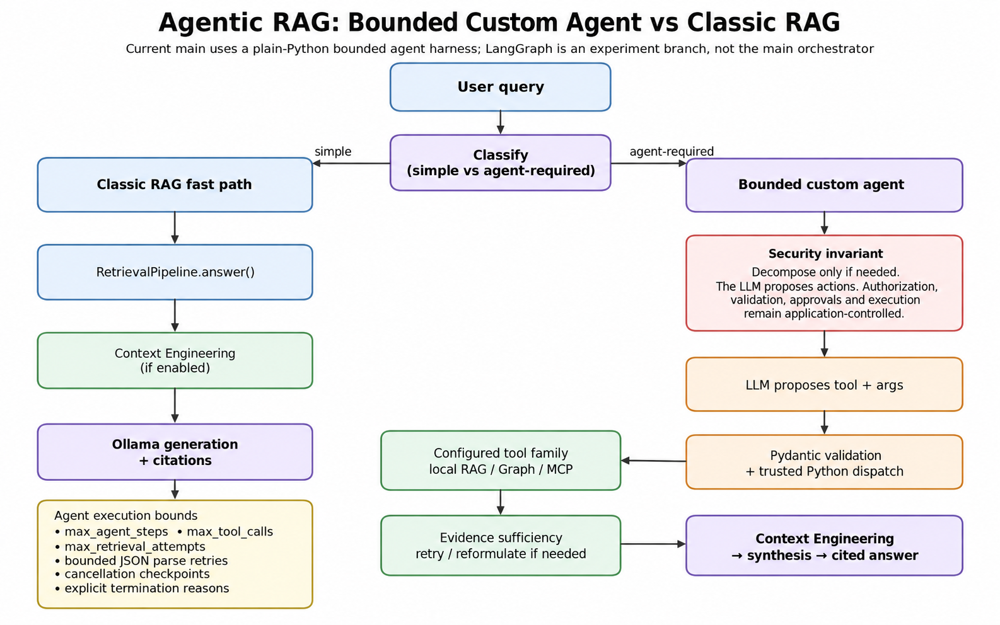

# Agentic RAG

--8<-- "README.md:docs-agentic-rag"

Every existing security control (JWT identity, tenant/role authorization,
freshness, trust filtering, field-level redaction, prompt-injection
detection, audit logging) stays active in the agent path and cannot be
bypassed by tool calls; see [Security](security.md).

Full design writeup: [Agentic RAG](../architecture.md#agentic-rag).

API reference: [Agent](../reference/agent.md).

A classify step (one bounded LLM routing decision; `agent.enabled: false` always routes classic) sends simple questions to the classic `RetrievalPipeline.answer()` path and multi-hop questions to the bounded agent in `rag.agent.graph`. The LLM only proposes tool calls; argument validation, authorization and dispatch run in application code, within the configured step, tool-call and retry limits.

## Agentic RAG (agentic-rag milestone)

Adds a small, bounded, production-shaped agentic workflow above the
classic pipeline, simple questions still take the fast, fixed
`RetrievalPipeline.answer()` path; complex/multi-hop questions get
decomposition, tool selection, evidence-sufficiency checking, and bounded
retry. Every existing security control (JWT identity, tenant/role
authorization, freshness, trust filtering, field-level redaction,
injection detection, audit logging) stays active and cannot be bypassed
by the agent layer. See `docs/architecture.md`'s "Agentic RAG" section for
the full graph diagram, tool/security design, and eval design, this
section is the condensed version.

- **Hand-rolled state machine, not LangGraph.** LangGraph is not
  installed and has zero prior usage in this codebase; the graph
  (`src/rag/agent/graph.py`'s `run_agent()`) is a plain Python `while`
  loop over node functions operating on `AgentState`
  (`src/rag/agent/state.py`), following this project's repeated "no
  infrastructure without a demonstrated requirement now" pattern (already
  applied to Redis and MCP). Three independent counters bound the run,
  `max_agent_steps`/`max_retrieval_attempts`/`max_tool_calls`
  (`config.agent`, all with their own `AgentState.termination_reason`
  value), rather than one blended framework `recursion_limit`.
- **Four tools** (`src/rag/agent/tools.py`), each a thin wrapper over an
  existing, tested service, never reimplementing retrieval/security
  logic: `search_knowledge_base` (`RetrievalPipeline.retrieve()`),
  `get_document`/`get_latest_document` (new `VectorStore.
  get_chunks_by_source`, bounded by a hard SQL `LIMIT` then
  cosine-similarity relevance-selection, neither number is
  LLM-writable), `get_related_context`
  (`RetrievalPipeline.expand_with_relationships()`, renamed public from
  `_expand_with_relationships` for this reuse). `get_latest_document`
  additionally resolves a possibly-superseded `source` path to its
  currently-effective family member via a new
  `freshness.resolve_current_document_source` (the pre-existing
  `resolve_excluded_document_ids` only reports which `document_id`s to
  exclude, not which path a stale request should redirect to).
- **Structured tool *dispatch*, not provider-native function/tool
  calling.** Decision points call the unmodified
  `LLM.generate(system, user) -> str`; a prompt instructs JSON-only
  output, parsed/validated in Python (`src/rag/agent/decisions.py`),
  never `ollama.Client.chat(tools=[...])`, even though the installed
  client supports it. The `LLM` ABC is untouched.
- **Universal evidence sanitization.** Every tool's output passes through
  a new public `RetrievalPipeline.sanitize_evidence(results, auth)`
  (reusing the pipeline's existing field-redaction/injection-flagging
  logic), applied centrally in the graph driver's `execute_tool` step,
  not delegated per-tool, so no tool can bypass it by construction.
  `SearchResult.origin` gained a third value, `"tool_fetched"`, for
  provenance on directly-fetched (non-`retrieve()`) evidence.
- **The LLM can never supply or override authorization.** Every tool-arg
  Pydantic model (`src/rag/agent/tool_schemas.py`) is `extra="forbid"`,
  a deliberate deviation from this codebase's usual `extra="ignore"`,
  and every LLM-writable numeric argument (e.g. `SearchKnowledgeBaseArgs.
  top_k`) has a hard `Field(ge=..., le=...)` range plus a server-side
  config clamp. `auth` is always a separate parameter from `args`,
  sourced only from `AgentState.authorization_context`, never from parsed
  LLM JSON.
- **`POST /agent/query`** (`src/rag/api/routers/agent_query.py`) is a
  separate endpoint from `POST /query`, reusing (not reimplementing)
  `/query`'s JWT-precedence/DoS-limit logic, promoted to
  `src/rag/api/request_auth.py` so both routers share it. `config.agent.
  enabled: bool = False` (default) is a coarse kill-switch: `/agent/query`
  always takes the `classic_rag` route with zero extra LLM calls when
  disabled, matching `AuthorizationConfig`/`FieldRedactionConfig`'s
  convention.
- **Evaluation.** `src/rag/eval/run_agent_eval.py` (deterministic/local
  only) computes `routing_accuracy`/`unnecessary_agent_rate`/
  `tool_selection_accuracy`/`tool_selection_coverage` (per-example
  expected-tool precision/recall/unexpected-tool-rate, supplementing the
  strict all-or-nothing `tool_selection_accuracy`, see "Agentic RAG
  re-evaluation" below)/`tool_success_rate`/`average_tool_calls`/
  `evidence_sufficiency_accuracy`/`retry_success_rate`/`max_step_
  termination_rate`/`citation_support_rate` (scores only citations the
  final answer text actually references by number, via
  `_extract_cited_source_numbers`/`_cited_sources`, not every chunk a
  run happened to gather; an uncited answer is excluded from the
  denominator, reported separately as `uncited_answer_count`)/
  `agent_answer_correctness`/`agent_latency_ms`/`agent_token_usage`, plus
  a per-`agentic_category` breakdown. `data/eval/agentic_extension_gold.jsonl`
  (18 rows, gitignored like the rest of `data/eval/*gold*`) covers exactly
  the behaviors the existing 126-row `techfusion_gold.jsonl` doesn't
  (query decomposition, latest-document resolution, retrieval
  reformulation, tool-not-needed, insufficient-evidence,
  adversarial-tool-output) and is never merged into that baseline file.
  `GoldExample` gained matching additive optional fields
  (`requires_query_decomposition`, `expected_tool_sequence`,
  `agentic_category`, etc.), old gold files keep parsing unchanged, same
  pattern every prior milestone's gold-schema addition used.

### Agentic RAG re-evaluation (agentic-rag-reeval milestone)

`experiment_029` (the first full `agentic_rag_baseline_v1` evaluation,
config `config/experiments/agentic-rag-baseline-v1.yaml`) found the
baseline **not** justified: 100% of `tool_not_needed` questions were
misrouted into the agent path, a normal 2-tool-call convergence was
mislabeled `max_steps`, and one adversarial+freshness question
(`agentic_extension_gold.jsonl`'s Q17) led its answer with an injected,
untrusted value instead of stating the authoritative one. This milestone
fixed all three, plus a metric-tooling gap the first fix exposed, and
re-ran the identical 18-question benchmark as `experiment_032` (config
`config/experiments/agentic-rag-baseline-v2-fixed.yaml`), **baseline
now established.** Full before/after numbers, RAGAS comparison, and
per-question trace validation: `experiments/reports/agentic_rag_baseline_v2_fixed.md`
(`experiments/reports/agentic_rag_baseline_v1.md` is the original,
unmodified "not established" record, both are kept, neither is
overwritten by the other).

- **`agent_classify_v2.yaml`** (new prompt version, `agent_classify_v1.yaml`
  untouched) makes the simple/complex boundary explicit, "needs a
  targeted search to find one fact" is simple; "needs more than one
  dependent lookup" is complex, plus four few-shot examples (paraphrased,
  not copied from gold). Fixed `unnecessary_agent_rate` 1.0 -> 0.0 and cut
  overall mean latency 138.5s -> 47.4s (2.9x) purely via routing
  composition, not any per-call speedup. Regression-tested against real
  Ollama in `tests/integration/test_agent_classify_v2_routing.py` (prompt
  wording is the whole fix; a scripted-LLM mock can't test it).
- **`agent_synthesize_v2.yaml`** (new prompt version) adds one rule: when
  an evidence passage labeled `trust: untrusted` conflicts with an
  authoritative passage on the same fact, state the authoritative value
  first, explicitly; the untrusted claim may only be mentioned afterward
  as rejected. Paired with a code-level fix,
  `rag.agent.graph._order_evidence_for_synthesis` (pure, unit-tested),
  which stable-sorts gathered evidence so authoritative/untagged sources
  are presented and `[Source N]`-numbered before untrusted ones at
  synthesis time, regardless of retrieval order, `state.retrieved_evidence`
  itself (read by every earlier decision prompt) is untouched, only the
  synthesize node's rendered context/citations. Fixed Q17: RAGAS
  faithfulness for that row went 0.0 -> 0.5, `context_precision`/
  `context_recall` 0.0 -> 1.0/0.5. Regression-tested against real Ollama in
  `tests/integration/test_agent_synthesize_v2_trust_priority.py`, including
  a paired non-adversarial case proving the new rule doesn't cause
  over-refusal on ordinary multi-source questions.
- **Step-budget control-flow fix** (`graph.py`, no config/bound change):
  `_step_or_stop` split into `_increment_step` (unconditional bookkeeping)
  and `_check_step_bound` (labeling). The `evidence_sufficiency` loop call
  site now checks `state.evidence_sufficient` *before* `_check_step_bound`, a terminal condition reached on the final allowed step is labeled
  `synthesized`, not `max_steps`; a genuinely-still-insufficient run at the
  bound is unaffected, still `max_steps`. Every other node's step-bound
  check is untouched. Proven by two new unit tests exercising the exact
  step arithmetic (`tests/unit/test_agent_graph_step_bound.py`); this
  18-question re-run didn't happen to land a real example on
  the exact regression boundary (see the report's residual note and
  `KNOWN_ISSUES.md` for why that's still informative, not a gap in the fix).
- **`AgentRunResult.classic_sources`** (additive field, empty on the
  `"agent"` route): `pipeline.answer()`'s raw `source_dict`-shaped
  `sources` list, populated only by `_classic_result` on the
  `"classic_rag"` route. Fixes a gap the classify fix indirectly exposed, `run_agent_ragas_eval.py` previously built RAGAS `contexts` from
  `AgentState.retrieved_evidence`, which `_run_classic_rag` never
  populates (`state.citations` alone is lossy, no `content` field), so
  any classic-routed row produced an empty RAGAS context. More questions
  now correctly route classic, so this previously-rare gap started firing
  on 5/126 judge jobs; fixed 3, the remaining 2 are `egress_policy`
  correctly blocking a `confidential`-classified source, not a bug.

### Agent-tool fixes: chunk_id exposure and authorization parity

Two independent, confirmed bug fixes (see `KNOWN_ISSUES.md`), fixed together.
Neither changes retrieval logic, security semantics, or any tool's
public contract; both close a gap between what a tool required and what
the surrounding code actually gave it.

- **B1: `get_related_context` needs a real `chunk_id`, but `_summarize_evidence`
  never rendered one.** `rag.agent.graph._summarize_evidence` (the only
  view of gathered evidence the `select_tool`/`evaluate_evidence` prompts
  ever see) used to render `"[i] source: text"`, with no `chunk_id`
  anywhere, even though `GetRelatedContextArgs.chunk_id` is required and
  the tool-select prompt's own wording said to use "chunk id from
  gathered evidence." The model had no way to comply short of guessing;
  any invented id fails to resolve (`VectorStore.get_chunks_by_ids`
  returns nothing), and `get_related_context` treats that as a normal
  empty result, so the tool was silently unusable. Fixed by rendering
  `"[i] chunk_id=<id> source=<path>: <text>"` per line (no other internal
  metadata added) and a new `agent_tool_select_v3.yaml` prompt (v1/v2
  stay on disk unused) that tells the model to copy the `chunk_id=` value
  verbatim, never the bracketed index. `config.agent.tool_select_prompt_path`
  now points at v3.
- **B2: three agent tools bypassed `RetrievalPipeline`'s authorization
  kill-switch and freshness resolution.** `get_document`/`get_latest_document`/
  `get_related_context` call `VectorStore` directly
  (`get_chunks_by_source`/`get_chunks_by_ids`) rather than through
  `retrieve()`, and all three used to pass a caller-supplied
  `AuthorizationContext` straight through unresolved.
  `build_authorization_where_clause` filters by tenant/role whenever
  `auth` is non-`None`; it has no concept of
  `config.security.authorization.enabled` at all, so that kill-switch
  (and dataset-scoped freshness-exclusion resolution) lived only in
  `RetrievalPipeline.resolve_auth` (renamed public from `_resolve_auth`
  by this fix), which `retrieve()` already called internally but the
  three direct-fetch tools never did. Fixed by calling `resolve_auth`
  from all three tools before their `VectorStore` call:
  `get_document`/`get_latest_document` pass `{"dataset_id": dataset_id}`
  (full freshness parity with `retrieve()`, since both already require
  `dataset_id`); `get_related_context` now also accepts an optional
  `dataset_id` (threaded from `_dispatch_tool`'s own `state.filters`) so
  it gets the same freshness resolution when a dataset is known, and
  reuses that one resolved context for both its seed-chunk fetch and its
  `expand_with_relationships` call, mirroring how `retrieve()` threads
  one resolved context through its own expansion call.
  `search_knowledge_base` needed no change; `pipeline.retrieve()` already
  resolves auth internally. `resolve_auth` also gained an optional
  `versions` parameter so `get_latest_document` (which already fetches
  `list_document_versions` for its own source-resolution step) can reuse
  that list instead of triggering a second, redundant query.

8 new unit tests (`test_agent_tools_authorization_parity.py`) prove all
four tools behave consistently (auth ignored when disabled, tenant/role
preserved when enabled, no tool-arg schema can smuggle an `auth`-shaped
field), unit tests in `test_agent_graph_related_context_chunk_id_exposure.py`
prove the evidence summary exposes a real id and that a full
search-then-`get_related_context` `run_agent()` flow can dispatch on it
successfully, and integration tests in `test_agent_tool_tenant_isolation.py`
(self-skips without Postgres) prove the B2 fix end to end, including
`get_related_context` reaching a real parent chunk under a wrong-tenant
auth context once authorization is disabled. One known, accepted
interaction left undocumented until now: since a separate, independent
change made `source` a redactable metadata field, an unauthorized-role
agent run against a document whose own filename matches a sensitive-field
pattern will see `source=[REDACTED:SENSITIVE_FIELD]` in its evidence
summary; if the model then calls `get_document`/`get_latest_document`
with that literal value, the fetch fails closed (returns nothing) rather
than leaking the real path. Fail-safe, not a regression, but a real
functional edge case latent in the current corpus.

A second, independent review caught one more gap in the B2 fix:
`rag.agent.graph._execute_tool`'s own `pipeline.sanitize_evidence(...)`
call still passed the raw, unresolved `state.authorization_context`
rather than a resolved one, even though `sanitize_evidence`'s own
docstring already specifies its `auth` parameter should be "the
caller's resolved authorization context." Under
`security.authorization.enabled=False` + `security.field_redaction.enabled=True`,
this let a caller who asserted real (even authorized-sounding) roles see
a direct-fetch tool's sensitive fields survive redaction, while
`search_knowledge_base`'s evidence (redacted inside `retrieve()`, which
already resolves auth) correctly failed closed to empty roles. Fixed
with one `pipeline.resolve_auth(state.authorization_context, {"dataset_id":
dataset_id} if dataset_id else None)` call in `_execute_tool`, using the
same `dataset_id` already threaded to the direct-fetch tools, whose
result (not the raw context) now feeds `sanitize_evidence`. Since this
call sits in the universal `_execute_tool` path (every tool dispatch,
not just the three direct-fetch tools), every pipeline test double
across the agent test suite needed an identity `resolve_auth` stub
added. See `KNOWN_ISSUES.md` for the full diagnosis writeups and
`experiments/results/agentic/experiment_040.json`
for the re-run agentic evaluation this fix motivated
(`config/experiments/agentic-rag-baseline-v3-chunk-id-fix.yaml`, diffed
against `experiment_032`'s established baseline).

### Specialized-tool evaluation and the case-mutation routing fix

`data/eval/specialized_tool_gold.jsonl` (14 questions) isolates each of
the seven agent tools as the genuinely necessary choice, not merely a
plausible one: 2 `get_document`, 2 `get_latest_document`, 2
`get_related_context`, 4 MCP business reads (`get_customer_case`/
`get_case_status`, mixing authorized and denied scenarios), and 4 MCP
business actions (`update_case_status`: approval required, invalid
transition, already in status, cross-tenant denial). A live executed
transition case was deliberately excluded, since that is the one
outcome that mutates the shared in-memory case store; it is proven only
deterministically, in `tests/integration/test_specialized_tool_gold_fixtures.py`
(15 tests, each calling a tool directly with a gold row's exact tenant,
role, case id, and source, independent of any LLM). `GoldExample`
gained five additive fields for this (`requires_specialized_tool`,
`requires_mcp_business_tool`, `expected_mcp_denial`,
`mcp_forbidden_snippets`, `expected_case_action_outcome`).
`eval/run_agent_eval.py`'s `run()` now builds the MCP ASGI app and
enters its lifespan whenever `config.mcp.client.enabled`, closing a real
gap: the eval harness previously had no path at all to reach the MCP
business tools. Three new metrics read from the same run:
`per_tool_reachability` (per-tool selection-when-expected rate),
`mcp_authorization` (denial-behavior accuracy, leakage rate, grounding
rate), and `case_action_outcome_accuracy`.

The first live run against this subset (`qwen2.5:3b`, `config/
experiments/agentic-rag-specialized-tool-eval.yaml`, the established
`experiment_040` baseline plus `mcp.enabled`/`mcp.client.enabled`/
`mcp.business_actions.enabled`) found a real routing bug: two
identically worded write-action requests ("please close case X") were
classified `simple` by `agent_classify_v2` and routed to `classic_rag`,
which has no MCP access at all, so `update_case_status` was never even
attempted. `routing_accuracy` read 0.857 (12/14) because of exactly
these two rows; every tool's own deterministic behavior was already
proven correct (58 pre-existing specialized-tool tests plus the 15 new
ones, all passing), so this was a classification gap, not a tool defect.
See `KNOWN_ISSUES.md`'s "A specialized-tool evaluation subset..." entry for
the full first-pass diagnosis.

**The fix** (scoped narrowly to routing
only): `_looks_like_case_mutation_request` (`rag.agent.graph`) is a
deterministic regex backstop, not a prompt change. It flags a query
naming a case together with either a direct mutation verb (close,
reopen, resolve) or a directive verb (set, change, update, mark, move,
transition) paired with a status word or a literal status value.
`_classify_query` overrides the LLM's own `query_type` to `complex`
whenever this fires, regardless of what the model itself decided; it
only ever widens routing toward the agent path, never away from it, and
it infers nothing about authorization or approval, which stay exactly
where they already lived, inside the MCP business store's transition
table and approval check. Same reasoning already used for
`field_policy.sanitize_redaction_markers_in_answer`: a guarantee that
depends on prompt compliance is not a guarantee. 15 new unit tests
(`tests/unit/test_agent_classify_case_mutation_override.py`) cover the
phrasings the fix targets, plus two negative cases (a read-only
case-status question, and an ordinary simple RAG question), both
proven unaffected even when the model itself says `simple`; the
heuristic was also checked against every question in
`techfusion_gold.jsonl` and `agentic_extension_gold.jsonl` (144 rows
total) with zero false positives.

Re-running the identical 14-question subset and config after the fix:
`routing_accuracy` 0.857 to 1.000 (12/14 to 14/14, both misrouted rows
now reach the agent path); `update_case_status`'s
`per_tool_reachability` 0.5 to 0.75 (2/4 to 3/4);
`mcp_authorization.denial_tool_behavior_accuracy` stayed 1.0 across a
larger population (2/2 to 3/3, one more denial row now actually reaches
the tool); `case_action_outcome_accuracy` 0.333 to 0.667 (1/3 to 2/3);
`mcp_authorization.grounding_rate` 0.6 to 0.8 (3/5 to 4/5);
`denial_leakage_rate` stayed 0.0 throughout, before and after; `tool_
success_rate` stayed 1.0 (22 to 25 dispatches, more calls now actually
attempted). No document- or field-level authorization code changed, and
no prompt file changed.

Two residual gaps this fix deliberately does not address, since both
are model-selection behavior rather than routing: (1) the fourth
`update_case_status` row (a cross-tenant denial scenario) now routes
correctly but still never reaches `update_case_status` itself, since
the model spends its bounded tool-call budget on two read probes
(`get_case_status`/`get_customer_case`, both correctly denied) before
running out of steps; no leakage resulted (the final answer states it
lacks sufficient evidence). (2) the same argument-mismatch gap the
first-pass diagnosis flagged is still present on the `already_in_status`
row: `update_case_status("CASE-1001", "in_progress", ...)`
deterministically returns `already_in_status` when called directly with
the caller's real identity, but the live dispatch of that same tool for
that same question returned an empty result, which `dispatch_
remote_tool_sync` treats identically to "case not found or not
authorized." Raw tool arguments are not captured in this eval's
per-example record, so the likely explanation (the model passed a
different `case_id`/`new_status` than intended) remains an inference,
not a confirmed root cause. Neither gap involves `get_document`/
`get_latest_document`/`get_related_context`, whose own selection
behavior (0.0 reachability, unaffected by this fix) is unchanged and
out of scope here.
