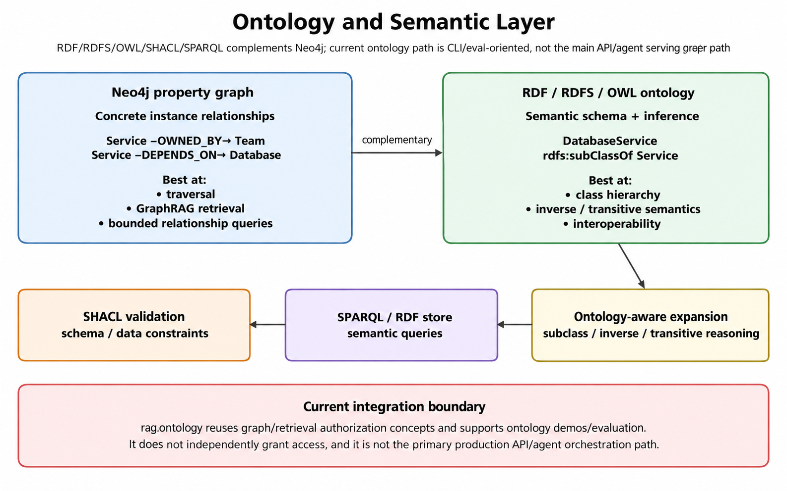

# Ontology and Semantic Layer

`rag.ontology` adds an RDF/RDFS/OWL/SHACL/SPARQL semantic layer over the same
TechFusion domain the [Knowledge Graph / GraphRAG](graphrag.md) milestone
already models in Neo4j. It is additive, like GraphRAG itself: nothing in
`src/rag/graph/` changes, and `rag.ontology` is not wired into `rag.api` or
`rag.agent`. Today it is reachable through `scripts/ontology_demo.py` and
`python -m rag.eval.run_ontology_eval`.

The point is the distinction GraphRAG's own flat Neo4j node labels do not
express: `tech:DatabaseService rdfs:subClassOf tech:Service` lets a query
for "every Service" also match something only ever typed `DatabaseService`,
a real recall improvement (naive 6/10 entities vs. ontology-aware 10/10
on a `Service` query, measured in `data/eval/ontology_gold.jsonl`), not a
hypothetical one.

Security is unchanged, not re-derived. `rag.ontology.authorization` reuses
`rag.graph.authorization.is_fact_authorized` and
`rag.retrieval.authorization.AuthorizationContext` directly, so ontology
reasoning (subclass/equivalence/inverse entailment) runs over facts already
subject to the same tenant/role check document-level retrieval uses, and an
inferred relationship never grants access on its own. See
[Security](security.md) for the control-by-control breakdown this reuses.

The RDF/OWL layer complements the Neo4j property graph with class hierarchy and inverse/transitive reasoning, SPARQL queries and SHACL validation. It is reachable from the demo script and the ontology evaluation only, not from the API or agent, and never grants access on its own.

## What RDF adds that the property graph does not

Neo4j's node labels (`Service`, `Database`, `API`, ...) are flat; there is
no Cypher statement anywhere that declares one a kind of another. This
ontology adds that subsumption explicitly (`rdfs:subClassOf`), plus a
handful of selective OWL characteristics. `tech:ownedBy` is
`owl:FunctionalProperty`, `tech:governedBy`/`tech:appliesTo` are mutual
`owl:inverseOf`, `tech:partOf` is the one `owl:TransitiveProperty` (chosen
deliberately: `tech:dependsOn`/`tech:supersedes` stay non-transitive,
matching `rag.graph.queries`'s bounded-depth traversal and
`rag.retrieval.freshness`'s union-find resolution respectively, not a
default).

## SHACL found a real bug, not a demo bug

Validating with and without RDFS inference disagreed once. A narrow
`rdfs:domain tech:Service` on `tech:dependsOn` let RDFS closure silently
retype an `Application` individual as a `Service`, since the real seed data
also uses `Application` as a `DEPENDS_ON` subject. Fixed by removing the
domain axiom and expressing the real constraint in SHACL instead, which
validates without manufacturing a new triple. That is the concrete answer to
"OWL reasoning and SHACL validation are different concepts." Full story in
`KNOWN_ISSUES.md` and `data/ontology/CHANGELOG.md`.

## Semantic interoperability and entity resolution

Three synthetic external systems' own class names
(`sap:Client`/`crm:Customer`/`svcnow:BusinessPartner`) map via real
`owl:equivalentClass` triples into `tech:Customer`, never a silent
rename. Entity resolution for one canonical customer produces three
different, real outcomes (a confirmed `owl:sameAs` link, a proposed-only
`tech:candidateSameAs` link not auto-promoted, and one deliberately
unresolved record), because "do not merge entities automatically without
evidence" is enforced by there being no code path that promotes a candidate
to confirmed.

The full design (class hierarchy, every RDF/RDFS/OWL/SHACL/SPARQL
concept worked through against real data, the Cypher-vs-SPARQL comparison,
the deterministic evaluation, and 25 interview questions) is in
[`docs/ontology.md`](../ontology.md).

API reference: [Ontology](../reference/ontology.md).

## Ontology and semantic layer (ontology milestone)

Adds an enterprise-style ontology/semantic layer, `rag.ontology`
(`src/rag/ontology/`), on top of the GraphRAG milestone's Neo4j property
graph. Additive, like GraphRAG itself: the Neo4j/property-graph
implementation is unmodified and remains the production retrieval path
(`POST /graph/query`, the agent's four graph tools); this milestone adds
a second, RDF-based semantic description of the same domain, used today
only through `scripts/ontology_demo.py` and
`python -m rag.eval.run_ontology_eval`, not wired into `rag.api`/
`rag.agent` at all. See `docs/ontology.md` for the full write-up
(architecture diagram, worked examples for every RDF/RDFS/OWL/SHACL/
SPARQL concept, the RDF-vs-property-graph comparison, and 25 interview
questions); this section is the condensed version. Install the optional
`ontology` extra first: `pip install -e .[ontology]` (`rdflib`, `owlrl`,
`pyshacl`).

- **Lives inside `src/rag/`, like every other milestone, and reuses
  `rag.*` directly where it is cheap to.** `rag.ontology.authorization`
  is a thin pass-through to `rag.graph.authorization.is_fact_authorized`
  and `rag.retrieval.authorization.AuthorizationContext` -- the exact
  same function and type, not a parallel reimplementation -- confirmed
  cheap to import directly (under 1.3s each, measured in this sandbox).
  The one import this codebase has documented as genuinely expensive is
  `rag.factory` specifically (sentence-transformers/torch at import
  time, ~19-22 minutes measured elsewhere in
  `distributed_state_experiment/README.md`, and ~49s measured directly
  in this session); `rag.ontology` never imports it, and
  `rag.graph.client`/`rag.graph.retrieval` (used by the live-Neo4j
  integration function below) were separately confirmed cheap too
  (under 1s each). Nothing in this package needed its own isolated
  venv -- `data/ontology/schema/techfusion_ontology_v1.ttl`'s data files
  live under `data/`, not packaged inside `src/rag/`, matching
  `data/graph_demo_docs/`'s precedent for the GraphRAG milestone's own
  demo assets, and resolved via `rag.config.REPO_ROOT`
  (`rag.ontology.paths`).
- **The ontology (`data/ontology/schema/techfusion_ontology_v1.ttl`,
  namespace `http://techfusion.example/ontology/v1#`, prefix `tech:`)
  models schema knowledge (B), never instance data (A)**: 17 classes,
  one per `rag.graph.schema.EntityType` label (each annotated with the
  exact Neo4j label it corresponds to, via a `tech:neo4jLabel`
  annotation property, cross-checked against the real `ENTITY_TYPES`
  allowlist by `tests/unit/test_ontology_store_and_loading.py` so the
  mapping stays correct if `EntityType` ever changes), plus semantic
  refinements the property graph's flat labels do not themselves
  declare (`tech:APIService`/`tech:DatabaseService`/
  `tech:MessagingService` as `tech:Service` subclasses;
  `tech:OperationalDocumentation` as a new umbrella over
  `tech:Policy`/`tech:Runbook`). 18 object properties (one per
  `rag.graph.schema.RelationshipType`, each annotated with
  `tech:neo4jRelationshipType`), with domain/range kept deliberately
  broad or absent (see the dependsOn bug below), and OWL characteristics
  applied selectively: `tech:ownedBy` is `owl:FunctionalProperty`,
  `tech:governedBy`/`tech:appliesTo` are mutual `owl:inverseOf`,
  `tech:partOf` is the one `owl:TransitiveProperty` (mereology is
  genuinely transitive), `tech:dependsOn`/`tech:supersedes` are
  deliberately **not** transitive, matching `rag.graph.queries`'s own
  bounded-depth Cypher traversal and `rag.retrieval.freshness`'s own
  union-find resolution, respectively, rather than introducing a second,
  conflicting notion of transitivity for either relationship.
- **A real bug, found by actually running SHACL validation against
  real data, not designed in**: `tech:dependsOn` originally declared
  `rdfs:domain tech:Service`. Because the real demo graph also has an
  `Application` subject for `DEPENDS_ON` (Alpha Internal Console),
  RDFS closure silently re-typed that Application as a `Service` purely
  from the domain axiom, making raw and RDFS-closed SHACL validation
  disagree. Fixed by removing the domain declaration and moving the
  real constraint into SHACL (`data/ontology/shapes/techfusion_shapes.ttl`'s
  `DependsOnEndpointsShape`, `sh:or` over `Service`/`Application`),
  which validates without ever manufacturing a new triple. See
  `KNOWN_ISSUES.md`'s "A narrow RDFS domain axiom..." entry and
  `data/ontology/CHANGELOG.md`.
- **A second, methodology-level finding from the same session**:
  `sh:targetClass`/`sh:class` turned out to already be subclass-aware
  under pyshacl's default (`inference=None`) -- the W3C SHACL
  Recommendation's own "SHACL instance" definition bakes in
  `rdf:type`/`rdfs:subClassOf*` closure as core semantics, independent
  of any separate inference pass. `inference="rdfs"` is a strictly
  broader, separate concept (full RDFS axiomatic closure, including
  the domain/range propagation that caused the bug above), not what
  first introduces subclass-awareness. Verified directly, not assumed;
  see `KNOWN_ISSUES.md`'s "SHACL was already subclass-aware..." entry.
- **SHACL shapes** (`data/ontology/shapes/techfusion_shapes.ttl`):
  `ServiceShape` (name + exactly one owning team), `CustomerCaseShape`
  (exactly one customer, status in the same fixed vocabulary
  `rag.mcp.business.store._VALID_TRANSITIONS` already uses),
  `DocumentShape` (source path + extraction method), and
  `DependsOnEndpointsShape`. Run against both a valid instance-data
  mirror (5 real violations: PostgreSQL/OpenSearch/Alpha Console
  Database/RAG Service/Kafka have no owning team in the actual demo
  graph, a genuine, honestly-kept data-quality finding) and a
  deliberately invalid fixture (7 violations, one per shape/rule).
- **Instance data mirrors the real Neo4j `techfusion_graph_demo`
  dataset exactly** (`data/ontology/instances/instances_graph_demo.ttl`,
  same entities and relationships `scripts/seed_graph_demo_data.py`
  writes), plus clearly labeled synthetic additions for
  `Customer`/`CustomerCase`/`Incident`/`Environment`
  (`data/ontology/instances/instances_customer_domain.ttl`, needed since
  the real demo graph does not yet populate those entity types).
- **Semantic interoperability and canonical entity resolution**
  (`data/ontology/instances/interoperability_mappings.ttl`,
  `data/ontology/instances/canonical_entity_resolution.ttl`): three
  synthetic external systems' own classes
  (`sap:Client`/`crm:Customer`/`svcnow:BusinessPartner`,
  `sap:ticket`/`crm:support_case`/`svcnow:incident`) mapped via real,
  inspectable `owl:equivalentClass` triples into `tech:Customer`/
  `tech:CustomerCase` -- deliberately **not** `tech:Incident` for the
  ServiceNow term, despite the shared English word, since the
  operational and customer-support senses are different concepts here.
  Entity resolution models three distinct, real outcomes for the same
  canonical customer: a confirmed `owl:sameAs` link (human-reviewed), a
  proposed-only `tech:candidateSameAs` link (a plain object property,
  never promoted automatically, carrying its own confidence/provenance),
  and one deliberately unresolved external record (an identity
  conflict, not a guessed merge). A found-while-testing subtlety: an
  individual can be entailed `tech:Customer`-typed purely via schema-level
  `owl:equivalentClass` (its own asserted external class maps there)
  even with zero instance-level identity resolution -- "type-compatible"
  and "is this specific entity" are tracked as separate claims.
- **Ontology-aware GraphRAG** (`rag.ontology.graphrag_integration`,
  `rag.ontology.query_expansion`): bounded `rdfs:subClassOf` expansion
  (both a hop-depth cap and a result-count cap, independent, never
  through the whole ontology) feeding a type-match retrieval function,
  compared directly against naive exact-type matching over the same RDF
  mirror of the real dataset. Measured: naive recall 6/10 entities for
  "every Service-type component" (misses `DatabaseService`/
  `MessagingService`-subclassed infrastructure, including the
  tenant-scoped Alpha Console Database); ontology-aware recall 10/10. A
  negative control (`DatabaseService`, which has no subclasses of its
  own) shows zero difference, confirming the aggregate improvement is
  selective, not universal, per this milestone's own "do not assume
  ontology always improves results" instruction.
  `expand_and_query_live_neo4j` maps expanded classes back to real
  `rag.graph.schema.EntityType` labels (via `tech:neo4jLabel`) and runs
  one bounded Cypher query through the real `rag.graph.client.
  Neo4jClient` -- implemented for real, not a stub, but not executed
  against a live Neo4j instance this session since none was running
  (`docker ps` found no containers); its fail-closed behavior against
  an unreachable port was confirmed manually.
- **Authorization runs after reasoning, never bypassed by it**
  (`rag.ontology.authorization`, reusing `rag.graph.authorization.
  is_fact_authorized` directly, see above): every test runs OWL-RL
  closure first, then checks authorization, proving an inferred fact
  about an entity (e.g. its entailed `tech:Service` membership) changes
  nothing about who may see the entity itself.
- **Deterministic evaluation** (`rag.eval.run_ontology_eval`,
  `data/eval/ontology_gold.jsonl`, 12 questions: subclass expansion x2,
  graph traversal x5, terminology mapping x2, entity resolution x2, one
  deliberately unanswerable): no LLM judge, no RAGAS, matching
  `rag.eval.run_graph_eval`'s own precedent for a small, exact-answer
  gold set. `answer_correctness` 12/12; `retrieval_recall` naive 0.867
  vs. ontology-aware 1.0, with the improvement landing entirely on the
  one question designed to need it. Latency is reported but not treated
  as a meaningful signal at this scale (an in-memory, ~460-triple
  graph; dominated by `rdflib` cold-start/parse overhead).
- **Governance/versioning** (`data/ontology/CHANGELOG.md`): the term
  namespace (`.../ontology/v1#`) stays fixed across non-breaking
  releases; only `owl:versionIRI`/`owl:versionInfo` change.
  `techfusion_ontology_v1_1.ttl` deprecates `tech:System` (kept,
  `owl:equivalentClass`-bridged to `tech:InfrastructureComponent`, never
  removed -- `rag.graph.schema.EntityType` still lists `"System"` as a
  legal Neo4j label) and adds `tech:Vendor` (pure addition). A breaking
  change would require a new major namespace; not needed so far.
- **RDF store**: `rdflib`'s in-memory `Graph` only
  (`rag.ontology.store.RdflibStore`, behind a small `RDFStoreBackend`
  protocol), per this milestone's own instruction to prefer RDFLib first
  and add a real SPARQL server (Fuseki/GraphDB) only with a demonstrated
  learning need -- none was identified, same "no infrastructure without
  a demonstrated requirement now" pattern this project already applies
  to Redis and MCP.
- **`scripts/ontology_demo.py`** is one consolidated, `--demo`-selectable
  CLI (`rdfs`/`domain-range-pitfall`/`owl`/`shacl`/`sparql`/
  `property-graph-vs-rdf`/`interop`/`auth`/`all`), matching
  `scripts/`'s established single-purpose-file convention rather than
  shipping eight separate top-level scripts.
- **Tests**: 40 pytest tests (`tests/unit/test_ontology_*.py`, part of
  the normal `pytest tests/` run) covering Turtle parsing, RDFS/OWL-RL
  inference (including the functional-property-forces-`owl:sameAs` and
  disjoint-class-violation fixtures), SHACL validation (valid and
  invalid data, both inference modes), bounded query expansion
  (including a synthetic deep chain proving both caps independently),
  authorization (including the inference-then-authorization ordering
  proof, reusing the real `rag.graph.authorization`/`rag.retrieval.
  authorization` types), interoperability mapping, and entity
  resolution -- all self-contained, no external services.
  `tests/unit/conftest.py`'s ontology fixtures import `rag.ontology`
  INSIDE each fixture function, not at module scope, so collecting the
  full `tests/unit` suite never requires the optional `ontology` extra
  to be installed; each test file also opens with
  `pytest.importorskip("rdflib")`/`"pyshacl"` for the same reason.
