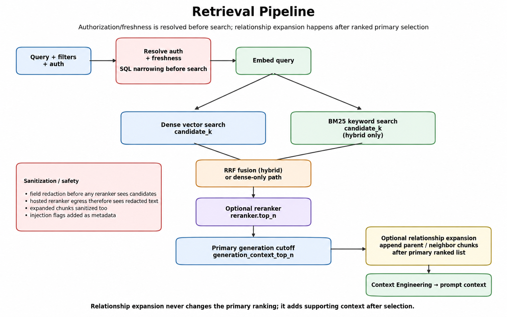

# Retrieval

`config.retrieval.provider` selects `dense` (pure vector similarity) or
`hybrid` (dense + BM25 keyword search, fused via Reciprocal Rank Fusion
before reranking). Fusion goes through rank position rather than
combining raw scores directly, since a cosine-similarity score and an
unbounded BM25 score are never on comparable scales.

Retrieval has three independent, explicitly-named cutoffs rather than one
overloaded "top k": `candidate_k` (how many candidates each branch fetches
from the vector store), `reranker_top_n` (how many a real reranker keeps
after rescoring), and `generation_context_top_n` (how many ranked chunks
reach the generation prompt). See
[Retrieval Cutoff Semantics](../architecture.md#retrieval-cutoff-semantics)
for why that split exists and what broke before it did.

An optional post-rerank relationship-expansion step and field-level
redaction pass both run inside the same retrieval pipeline; see
[Security](security.md) and
[Multimodal + Relationship-Aware Ingestion](../architecture.md#multimodal-relationship-aware-ingestion)
for those.

API reference: [Retrieval](../reference/retrieval.md), [Vector store](../reference/vectorstore.md).

Authorization and freshness are resolved before search; dense and (in hybrid mode) BM25 candidates are fused by RRF, optionally reranked, then cut to `generation_context_top_n`. Relationship expansion, when enabled, appends supporting chunks after that cutoff without changing the primary ranking.

## Retrieval: dense vs. hybrid

`config.retrieval.provider` is `dense` (default: pure vector similarity
search) or `hybrid` (dense + BM25 keyword search, each run at
`candidate_k`, fused via Reciprocal Rank Fusion before reranking,
`retrieval/pipeline.py:RetrievalPipeline.retrieve`, `retrieval/fusion.py`).
`VectorStore.search_keyword` is the BM25 side of that (implemented in
`pgvector.py`); its `.score` is an unbounded raw BM25 score, never
comparable to a cosine-similarity `.score` from `search()`, that's
exactly why fusion goes through rank position (`reciprocal_rank_fusion`,
`config.retrieval.hybrid.rrf_k`, default 60, the standard RRF/Elasticsearch/
Weaviate constant) rather than combining the two `.score` scales directly.
Fusion dedupes by `chunk.id` and sums `1/(k+rank)` contributions across
whichever lists a chunk appears in.

**BM25 cost scales with the corpus.** `search_keyword` fetches every chunk
matching the filters (no SQL `LIMIT`), tokenizes it, and builds a fresh
in-memory `BM25Okapi` index on each call, so hybrid latency is O(filtered
corpus) per query, not O(`candidate_k`). That is fine at this corpus size;
any dense-vs-hybrid latency comparison on a larger corpus measures this
rebuild, not BM25 itself. A persistent index (Postgres full-text search or
a cached BM25 per dataset) is the fix if that ever matters.

`RetrievalPipeline.retrieve_attribution` (additive, observability-only,
`retrieve()`/`answer()` are unaffected by its existence) always fetches
dense and BM25 independently and fuses them, regardless of
`config.retrieval.provider`, and never calls the reranker or relationship
expansion. `eval/retrieval_attribution.py` uses it to compute dense-only/
BM25-only/hybrid Recall/Hit-Rate/MRR against the same gold set, a
dense-vs-BM25 contribution bucket and an RRF-impact classification
(`rescued`/`improved`/`unchanged`/`degraded`) per question. On the full
84-question `techfusion` gold set: BM25 never independently finds a
document dense alone misses (`bm25_only_success = 0`); hybrid's
Recall@10 is actually slightly *lower* than dense-only's (fusion
demoting an already-correct dense top-1/2 result costs more at that
cutoff than it rescues), but hybrid clearly wins on MRR and
evidence-level `supporting_context_hit_rate`, see
`PROJECT_JOURNAL.md`'s 2026-08-13 attribution entry and
`experiments/results/attribution/experiment_016.json` for the full
numbers.

## Prompt templates

`config.generation.prompt` (`id`/`version`/`path`) selects a versioned
YAML prompt template under `src/rag/prompts/templates/`, loaded and
validated by `prompts/loader.py`. Each template declares
`system_template`/`user_template` (Python `str.format` syntax) plus a
`required_variables` list that's cross-checked at load time against the
actual `{placeholder}` names in both templates, a template with an
undeclared placeholder or an unused declared variable fails validation
immediately rather than failing at render time. `load_prompt_template_from_config`
additionally checks the loaded file's own `prompt_id`/`version` match what
config expects, catching a stale `path` pointing at the wrong version.
`RetrievalPipeline.answer()` renders with `context` (the reranked,
`[Source N: ...]`-labeled chunk text) and `query`. Bumping the prompt
version means adding a new template file and pointing `config.generation.
prompt` at it, old versions stay on disk for comparison, not overwritten.
